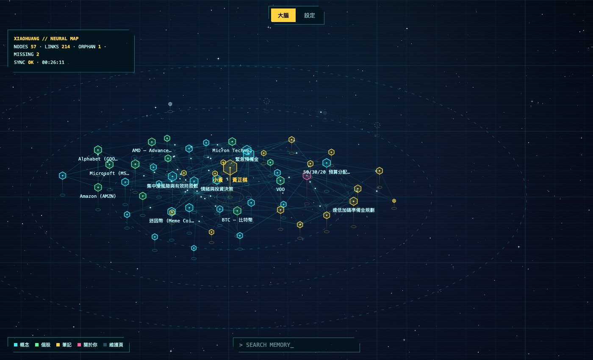

小黃（黃芷棋，Zoe）是一個跑在自己 Mac 上的個人 AI 夥伴：會聊天、記得你、懂投資但不報明牌，也能幫你打理一點生活。這篇只放重點：背景、技術棧、GitHub 和截圖。

<!--more-->

## Background

- **2026-06-13** 第一個 commit，一開始是學習用的 Discord 投資 bot。
- 一週內長出人格「小黃」、長期記憶，以及會自己長大的知識庫。
- 之後搬回 Mac 常駐，接上語音，長出三個殼：Mac 桌寵、Stack-chan 桌上機器人、本機 Dashboard。
- 定位從「投資終端」轉成**生活陪伴**：Notion、Mac 控制、她自己的瀏覽器、自己學技能、自己排程、派寫程式的工作。
- **2026-10-31** 發布 v2.4.0：2,136 個 commit、約 3.6 萬行 Python、約 4,900 個測試、14 個正式版本。

完整的過程寫在開發日記系列，從〈小黃誕生〉到〈小黃長大了〉。

## Tech Stack

| 類別 | 技術 |
|---|---|
| 核心 | Python、SQLite、markdown wiki（LLM Wiki） |
| 主腦 | Claude（Sonnet／Haiku）、Claude Agent SDK、Anthropic API、Codex CLI、Ollama |
| 平台 | Telegram Bot API（long polling） |
| 語音 | whisper.cpp（本機辨識）、PortAudio、ElevenLabs、OpenAI TTS |
| 圖像 | gpt-image-1（參考圖鎖臉）、Seedance（3D 轉頭影片） |
| 資料 | yfinance、Finnhub、Alpha Vantage、Binance、SEC |
| 整合 | Notion API、macOS 提醒事項／行事曆、Spotify、Chrome |
| 殼 | Swift（Mac 桌寵、選單列 app）、ESP32 M5Stack CoreS3＋PlatformIO（Stack-chan） |
| Dashboard | 原生 JavaScript＋d3 |
| 維運 | macOS launchd、git worktree、GitHub PR／Release |
| 開發 | Claude Code、pytest（突變驗證） |

## GitHub

👉 [RyanTokManMokMTM/investment-agent](https://github.com/RyanTokManMokMTM/investment-agent)

## Screenshots

**Dashboard：她的大腦圖**。知識庫的每一頁是一個神經元，中央是她自己。

**Mac 桌寵**：桌面上的一張圓臉，同時是她的麥克風和喇叭。

**Stack-chan 的像素房間**：待機時她窩在沙發上看書，背景跟著時間換。

> 小黃的回覆僅供學習與參考，不構成任何投資建議。
